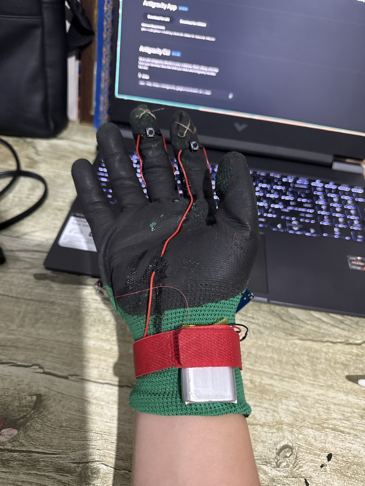

# 🧤 Glove Mouse — перчатка-мышь

Беспроводная Bluetooth-мышь в виде перчатки. Курсор двигается поворотом руки, клики — кнопками на кончиках пальцев.

## Как работает

- Гироскоп **MPU6050** на тыльной стороне ладони измеряет угловую скорость руки.
- **ESP32** переводит её в движение курсора и отправляет компьютеру по Bluetooth LE как обычную мышь.
- Две кнопки на пальцах: левый и правый клик.
- Питание от Li-Po аккумулятора на запястье, зарядка через USB-C.

## Компоненты

| Компонент | Назначение |
|---|---|
| ESP32 [модель платы] | Контроллер и Bluetooth |
| MPU6050 | Гироскоп |
| 2 тактовые кнопки | Левый и правый клик |
| Li-Po аккумулятор + модуль зарядки (USB-C) | Питание |
| Перчатка, провода, липучка | Основа и крепление |

## Подключение

| Что | Пин ESP32 |
|---|---|
| MPU6050 SDA | GPIO 5 |
| MPU6050 SCL | GPIO 6 |
| Левая кнопка | GPIO 3 → GND |
| Правая кнопка | GPIO 4 → GND |

MPU6050 питается от 3,3 В. Кнопки замыкаются на землю (внутренняя подтяжка `INPUT_PULLUP`).

## Установка

1. Установи [Arduino IDE](https://www.arduino.cc/en/software) и поддержку плат ESP32.
2. Установи библиотеку [ESP32-NimBLE-Mouse](https://github.com/wakwak-koba/ESP32-NimBLE-Mouse) (Скетч → Подключить библиотеку → Добавить .ZIP) и NimBLE-Arduino через Менеджер библиотек.
3. Открой `glove-mouse/glove-mouse.ino`, выбери свою плату и загрузи прошивку.

## Использование

1. Включи перчатку и держи руку неподвижно ~3 секунды: идёт калибровка гироскопа.
2. На компьютере подключись по Bluetooth к устройству **Glove Mouse**.
3. Двигай рукой для перемещения курсора, нажимай кнопки на пальцах для кликов.

## Настройка

В скетче можно менять:

- `SENS` — чувствительность курсора;
- мёртвую зону (`abs(vx) < 3`);
- сглаживание (коэффициенты `0.6` / `0.4`).

## Лицензия

MIT
